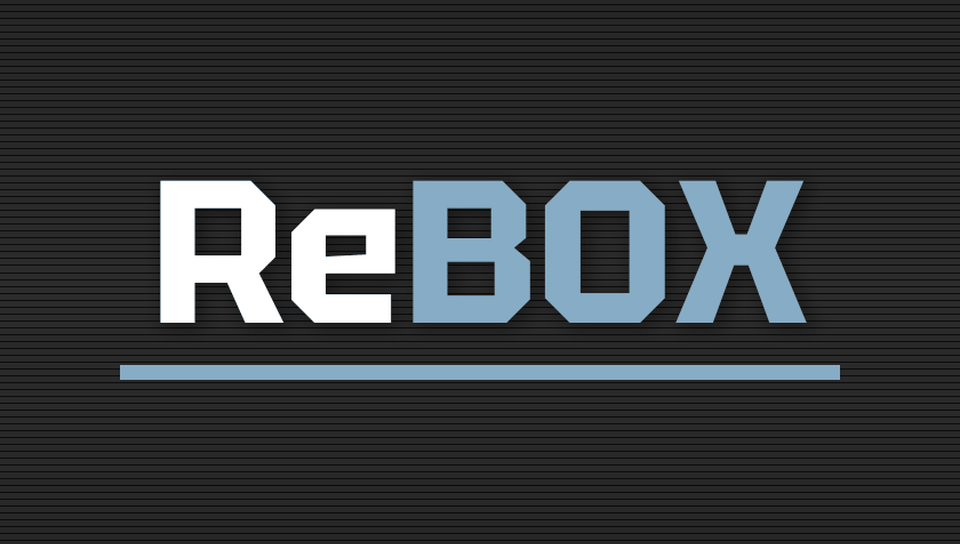

<p align="center">
  
</p>

<h1 align="center">ReBOX</h1>

<p align="center">
  <b>Arcade board emulator for PlayStation Vita</b><br>
  MAME drivers ported to C &middot; 22 makers, about 90 boards, 4454 sets
</p>

---

## Table of Contents

1. [Introduction](#1-introduction)
2. [Highlights](#2-highlights)
3. [Supported Boards](#3-supported-boards)
4. [Download](#4-download)
5. [Installation](#5-installation)
6. [Usage](#6-usage)
7. [Building from Source](#7-building-from-source)
8. [Project Layout](#8-project-layout)
9. [Accuracy and Testing](#9-accuracy-and-testing)
10. [License and Credits](#10-license-and-credits)
11. [Support](#11-support)

---

## 1. Introduction

ReBOX is an arcade board emulator for the PS Vita. It covers boards from Capcom, Taito, Data East, Konami, Sega, SNK,
Namco, Irem, Seibu, Cave, Midway, Atari, Toaplan and more.

Each board is a C port of its [MAME](https://www.mamedev.org/) driver: memory map, machine configuration, video
chips and sound chips follow MAME. The MAME device framework is not used; the drivers are written directly against a
small shared core, so that they run on a PS Vita at full speed.

The target for every game is a locked 60 fps on a PS Vita at 444 MHz without frame skipping, sound without dropouts,
and no errors that affect play. Every frame is emulated and drawn.

## 2. Highlights

**Core**
- Board drivers ported from MAME 0.289, from 8-bit classics up to CPS3, Sega System 32 and Y-Board, Cave CV1000, PGM, PGM2,
  Seibu SPI and the Midway T / Wolf / Y units (see [Supported Boards](#3-supported-boards)).
- CPUs:
  - Musashi (68000, 68EC020) and superzazu/z80.
  - Ports of MAME's cores: SH-2 and SH-3 (with a dynamic recompiler to ARM), V60 / V70, TMS34010, i386, ARM7,
    NEC V20-V35, HuC6280, HD6309, 6502, 6800, 6805, 6809, Konami, 8080, MCS-48 / 51, M37710, TLCS-90, ADSP-2100,
    TMS320C1x, TMS57002, PIC16C5x and uPD7810.
- Sound: ymfm for the Yamaha FM chips and ports of MAME's PCM and PSG chips (QSound, YMZ770, YMF271, ICS2115, C140,
  C352, MultiPCM, K054539, ES5505, OKI MSM6295, AY-3-8910, ...).
- Game lists, ROM layouts and input ports (with DIP switches) are generated from the MAME sources.
- Drawing and the heavier sound chips run on other CPU cores, so emulation, drawing and sound of a frame overlap.

**Frontend**
- Game list with a tab for each maker, grouped by board, genre, publisher or year, and a Playable / All /
  Favorites filter. Snaps and marquees from your own folders.
- Save states (10 slots plus quick save / load), DIP switches, test mode, cheats where the driver has them.
- Button mapping with turbo and combo keys, two players, external controllers. Bluetooth pads the Vita does not
  accept by itself work through the bundled [RePad](https://github.com/Reyanon/RePad) plugin.
- Touch buttons and touch in the game list and the menus.
- Display options:
  - screen size, rotation, filter;
  - scanlines (CRT soft / sharp, every 2 / 3 / 4 px);
  - border (black, graphic, color or marquee);
  - frame rate counter.
- Per-game settings, menu themes, and in-app updates from GitHub.
- Medal games (Taito O System) with an on-screen cabinet panel (lamps, hopper, medal counters).

## 3. Supported Boards

ReBOX runs **4454 sets**, parents and clones. Of the 20545 arcade sets that work in MAME 0.289, ReBOX runs
**4263 (21%)**.

The columns of the table:
- *Sets*: the number of sets ReBOX runs on that board.
- *Ported*: the share of the sets that MAME 0.289 runs on the same drivers.

A board below 100% has sets that are not done yet: for example another cabinet, a device that is not emulated, or
ROMs that do not match. The game list in the app shows every set with its board, year, publisher and genre. It also
shows the other working MAME boards that are not ported yet, greyed out.

| Maker | Board | Sets | Ported |
|---|---|---:|---:|
| **Capcom** | CPS1 | 212 | 93% |
|  | CPS2 | 323 | 100% |
|  | CPS3 | 61 | 100% |
|  | Classic boards (19 drivers: 1942, 1943, bionicc, blktiger, ...) | 162 | 87% |
| **Taito** | B System | 38 | 100% |
|  | F2 System | 68 | 96% |
|  | F3 System | 98 | 98% |
|  | H System | 9 | 100% |
|  | L System | 33 | 92% |
|  | O System | 2 | 100% |
|  | SJ System | 28 | 100% |
|  | X System | 10 | 100% |
|  | Z System | 37 | 100% |
|  | Classic boards (33 drivers: 40love, 8080bw, arkanoid, bking, ...) | 154 | 50% |
|  | Single-game boards (25 drivers: arkanoid, asuka, bigevglf, bublbobl, ...) | 220 | 91% |
| **Data East** | DECO 156 | 19 | 100% |
|  | DECO 16 | 115 | 97% |
|  | DECO 32 | 26 | 90% |
|  | DECO Cassette | 61 | 100% |
|  | DECO dec0 | 35 | 90% |
|  | DECO dec8 | 32 | 100% |
|  | DECO Karnov | 7 | 70% |
|  | DECO MLC | 12 | 86% |
|  | Classic boards (13 drivers: astrof, btime, bwing, chanbara, ...) | 88 | 97% |
|  | Single-game boards (11 drivers: actfancr, battlera, brkthru, compgolf, ...) | 44 | 98% |
| **Konami** | GX | 22 | 54% |
|  | Medal | 27 | 100% |
|  | Mystic Warriors | 30 | 97% |
|  | Nemesis | 19 | 83% |
|  | Super Contra | 10 | 100% |
|  | TMNT | 17 | 94% |
|  | TMNT 2 | 38 | 88% |
|  | Twin 16 | 14 | 100% |
|  | Classic boards (22 drivers: circusc, finalizr, gberet, gyruss, ...) | 75 | 82% |
|  | Single-game boards (36 drivers: 88games, ajax, aliens, asterix, ...) | 177 | 93% |
| **Sega** | System 16 | 210 | 89% |
|  | System 24 | 27 | 100% |
|  | System 32 | 54 | 86% |
|  | X-Board | 39 | 91% |
|  | Y-Board | 20 | 95% |
| **SNK** | Alpha 68K | 27 | 100% |
|  | Neo Geo | 241 | 85% |
|  | SNK 68000 | 16 | 94% |
|  | Single-game boards (1 drivers: prehisle) | 5 | 100% |
| **Seibu** | COP | 66 | 89% |
|  | SPI | 60 | 100% |
|  | Wiz | 10 | 100% |
|  | Classic boards (1 drivers: kncljoe) | 3 | 100% |
|  | Single-game boards (17 drivers: airraid, bloodbro, cabal, darkmist, ...) | 64 | 86% |
| **Namco** | 8-bit | 33 | 100% |
|  | NA-1/NA-2 | 26 | 100% |
|  | NB-1/NB-2 | 21 | 100% |
|  | System 1 | 40 | 100% |
|  | System 2 | 61 | 100% |
|  | System 86 | 11 | 100% |
| **Irem** | M107 | 6 | 100% |
|  | M52 | 4 | 100% |
|  | M57 | 2 | 100% |
|  | M58 | 6 | 100% |
|  | M62 | 26 | 100% |
|  | M63 | 4 | 100% |
|  | M72 | 45 | 88% |
|  | M90 | 19 | 100% |
|  | M92 | 40 | 95% |
|  | Classic boards (7 drivers: m10, m14, olibochu, redalert, ...) | 38 | 97% |
| **IGS** | PGM | 150 | 100% |
|  | PGM2 | 22 | 77% |
| **Midway** | T-Unit | 29 | 100% |
|  | Wolf Unit | 25 | 100% |
|  | Y-Unit | 43 | 73% |
| **Atari** | Gauntlet | 28 | 100% |
|  | System 1 | 27 | 100% |
|  | Single-game boards (8 drivers: blstroid, cyberbal, eprom, klax, ...) | 40 | 82% |
| **Technos** | Double Dragon | 23 | 85% |
|  | Double Dragon 3 | 16 | 100% |
|  | Classic boards (6 drivers: bogeyman, dogfgt, matmania, mystston, ...) | 13 | 87% |
|  | Single-game boards (10 drivers: battlane, blockout, chinagat, matmania, ...) | 42 | 93% |
| **Cave** | Cave | 63 | 88% |
|  | CV1000 | 29 | 100% |
| **Toaplan** | GP9001 | 57 | 81% |
|  | Toaplan 1 | 13 | 57% |
|  | Twin Cobra | 20 | 100% |
| **Seta** | Seta Hardware | 67 | 100% |
| **Jaleco** | Mega System 1 | 54 | 98% |
| **Psikyo** | 68EC020 | 17 | 89% |
|  | PS3/PS5 | 14 | 88% |
|  | PS4 | 8 | 100% |
| **Kaneko** | Kaneko16 | 38 | 100% |
| **NMK** | NMK16 | 36 | 36% |
| **Video System** | Video System | 32 | 100% |
| **Tecmo** | Ninja Gaiden | 14 | 93% |
|  | Tecmo 16 | 7 | 100% |
|  | Single-game boards (1 drivers: spbactn) | 2 | 67% |

**Speed.** The heaviest game of each board was measured on a PS Vita at 444 MHz in play (coin, start, buttons
pressed):
- 108 of the 125 games measured hold 60 fps.
- 11 more drop below 60 fps only in a few heavy moments.

Known slower games:

| Set | FPS | Notes |
|---|---|---|
| `tdragon2` (Thunder Dragon 2) | about 40 | NMK16: the drawing is too heavy for now |
| `tattass` (Tattoo Assassins) | about 45 | the BSMT2000 sound DSP is too heavy |
| `luckywld` (Lucky & Wild) | about 57 | drawing |
| `wpksoc`, `kftgoal` (Irem M107 football) | about 57 | during the match |
| `mk` (Mortal Kombat) | about 57 | the sound board |
| `ibara`, `espgal2`, `ddpdfk` (Cave CV1000) | 55-60 | slowdown in the heaviest bullet patterns |

**Fourth CPU core.** The speed was measured with the Vita's fourth CPU core open to the app.
- ReBOX opens it by itself when the system code matches the one verified on firmware 3.65.
- With the core closed, the heaviest games run slower.

The app sets 444 MHz by itself, so an overclock plugin is not needed.

**Known issues**
- Irem 8-bit boards (M52, M58, M62, M63): sound is the plain mix of the AY and MSM chips, without the board's filter
  and drum circuits.
- Seibu SPI cartridge sets write their sound flash on the first start. That first start takes several minutes; later
  starts are immediate.
- Some sets list ROM files that are not in the MAME 0.260 romsets, for example `cameltry`, `wgp2`, `dietgo`,
  `brkthru` and `progear`. They stay in the list and start when the zip has the files that MAME 0.289 expects.

## 4. Download

Prebuilt binaries are published on the [Releases](../../releases) page:

| File | Platform | Contents |
|---|---|---|
| `ReBOX_vX.Y.Z_vita.zip` | PS Vita / PS TV | `ReBOX_vX.Y.Z_vita.vpk`, the game lists in `data/rebox/gamelist/` and an empty `data/rebox/roms/` folder |

The releases contain the emulator only. **No ROMs or game artwork are included or provided.**
You must supply ROM images of games you own.

## 5. Installation

### PS Vita

Requirements:
- A PS Vita or PS TV that can install homebrew VPK files with [VitaShell](https://github.com/TheOfficialFloW/VitaShell).
- No extra plugin or system file is needed.

**Install the VPK**

1. Extract `ReBOX_vX.Y.Z_vita.zip` on your PC.
2. Start VitaShell on the Vita and connect it to the PC:
   - USB: press **SELECT** in VitaShell, connect the cable, and the memory card appears as a drive; or
   - FTP: press **SELECT** in VitaShell and connect an FTP client to the address shown on screen.
3. Copy `ReBOX_vX.Y.Z_vita.vpk` to `ux0:` (any folder, for example `ux0:downloads/`).
4. Disconnect, open the folder in VitaShell, select the `.vpk` and press **X** to install.
   Accept the extended permissions prompt. A **ReBOX** bubble appears on the home screen (title ID `RBOX00001`).
5. The `.vpk` file can be deleted after installation.

**Add ROMs**

1. The game lists are also inside the VPK. At start, ReBOX copies any list missing from `ux0:data/rebox/gamelist/`
   there. Lists already in that folder are never overwritten, so your own edits stay. Copying the zip's `data`
   folder to `ux0:` is optional.
2. Put your ROM zips in `ux0:data/rebox/roms/`, unchanged and not extracted, for example
   `ux0:data/rebox/roms/pbobble.zip`.
3. Start ReBOX. The *Playable* filter shows the sets whose zip was found.

Updates installed from inside the app also refresh the game lists.

### ROM sets

**Which MAME version.** Use **non-merged romsets from MAME 0.260**: ReBOX is tested with that romset version.
- The drivers and the set list come from the MAME 0.289 source.
- The ROM files of almost every set are the same in 0.260 and 0.289, so 0.289 non-merged romsets work too.
- A few sets changed after 0.260 (see Known issues).
- Romsets older than 0.260 are not tested.

**Non-merged or split.** Non-merged sets are recommended, because each zip has everything. Split sets also work when
the parent zip is in the same folder, because a clone set reads its missing files from the parent zip.

**Zip names.** Keep each set as one zip named after the set, for example `pbobble.zip`. Do not rename or extract the
zips. Files inside a zip are matched by CRC32, so their names do not matter.

**BIOS zips.** Non-merged sets already contain the BIOS files, so no separate BIOS zip is needed. With split sets,
put the BIOS zip in the same folder as the games, as in MAME: `neogeo.zip` (Neo Geo), `pgm.zip` (IGS PGM),
`konamigx.zip` (Konami GX), `decocass.zip` (DECO Cassette).

**Neo Geo BIOS.** Settings > BIOS > Neo Geo picks the BIOS a Neo Geo game starts with: the Europe, US, Asia and Japan
MVS BIOSes or the Universe BIOS 1.0 to 4.0 (MAME's list). It is used from the next game start. The BIOS file comes
from the game's zip (non-merged sets have them all) or `neogeo.zip`; when it is missing, the default Europe MVS BIOS
is used.

**CPS3 and CHD.** CPS3 uses the "no CD" sets, for example `sfiii3n`, `jojoban` and `redearthn`. CHD images are not
used.

### Optional files

| What | Path |
|---|---|
| Game lists (tabs, titles, boards, genres, paths; editable JSON) | `ux0:data/rebox/gamelist/*.json` and `gamelist/<folder>/*.json` |
| Border artwork | `ux0:data/rebox/artwork/<set>.png` (or `.jpg`) |
| Snaps shown in the game list | `ux0:data/rebox/snap/<set>.png` (or `.jpg`) |
| Videos shown in the game list | `ux0:data/rebox/video/<set>.mp4` |
| Marquees (*Marquee* border) | `ux0:data/rebox/marquee/<set>.png` (or `.jpg`) |
| MAME cheats | `ux0:data/rebox/cheats/cheat.zip`, or `ux0:data/rebox/cheats/<set>.xml` (see [Cheats](#cheats)) |

**Other folders.** Settings > Folders adds two more ROM folders (for example RetroArch's) and a snap and a marquee
folder. Pictures there are found by set name (`<set>.png` / `.jpg`) or by RetroArch's thumbnail names (the game's
title). The game lists' paths do not need to change.

**Game list entries.** Each game in a list names its files:

```json
{"rompath":"/roms/shuuz.zip","title":"Shuuz (version 8.0)","board":"Standalone","publisher":"Atari Games",
 "year":"1990","genre":"Puzzle","marquee":"/marquee/shuuz.png","snap":"/snap/shuuz.png",
 "video":"/video/shuuz.mp4","description":null}
```

- The paths:
  - A path that starts with `/` is in `ux0:data/rebox/`.
  - A full path such as `ux0:roms/shuuz.zip` is used as it is.
  - The ROM file's name (without `.zip`) is the MAME set name.
  - ROMs in another folder are found there too.
- The list files:
  - Every `.json` in `gamelist/` and in its folders is read.
  - Lists with the same tab name are merged.
  - ReBOX adds the lists it ships when they are missing and never overwrites a list already there.

### Cheats

ReBOX reads MAME's cheat files (the XML format of MAME's `cheat.7z`) for every board: the cheats act on the main CPU
(68000, Z80, 6809, 6502, SH-2, SH-3, ARM, V30 / V33, V60, i386, TMS34010 and the others). Cheats for a game's other
CPUs (sound CPUs, MCUs) are left out. In a game, open the menu (SELECT + START) and choose *Cheats*.

**Automatic install**

1. In the game list, press START to open the options.
2. Choose *Content Download* > *Cheats*.
3. ReBOX downloads `cheat.zip` (about 4 MB) from the
   [resources release](https://github.com/Reyanon/ReBOX/releases/tag/resources) and puts it in place. The Vita needs
   a network connection.

**Manual install**

1. Download `cheat.zip` from the
   [resources release](https://github.com/Reyanon/ReBOX/releases/tag/resources) on a PC.
2. Copy it, without unpacking it, to this path on the Vita (VitaShell, FTP or USB):

   ```
   ux0:data/rebox/cheats/cheat.zip
   ```

3. Start the game again.

The zip holds one `<set>.xml` per game. A single game's file can also be copied by itself to
`ux0:data/rebox/cheats/<set>.xml` (for example `ux0:data/rebox/cheats/kof98.xml`); it is used before the one in the
zip. A clone without its own file uses its parent's.

Files written by the emulator:

| What | Path |
|---|---|
| Settings and favorites | `ux0:data/rebox/settings.cfg`, `ux0:data/rebox/favorites.cfg` |
| Per-game settings | `ux0:data/rebox/cfg/` |
| Touch button layout | `ux0:data/rebox/touch.cfg` |
| NVRAM and EEPROM (high scores, test mode settings) | `ux0:data/rebox/nvram/` |
| Save states | `ux0:data/rebox/states/<set>_<slot>.sav` |

## 6. Usage

**Game list**

| Action | Buttons |
|---|---|
| Start the selected game | Cross (or Circle, see Controls) |
| Change tab (maker) | L / R |
| Add / remove favorite | Square |
| Search by ROM name or title | Triangle (again: all games) |
| Filter: Playable / All / Favorites | SELECT |
| Options (Display, Controls, About) | START, or the buttons at the bottom of the screen |

**In game**

| Action | Buttons |
|---|---|
| Lever | D-pad and left stick |
| Buttons 1-6 | Face buttons, L, R (set in Controls, per game if wanted) |
| Coin / Start | SELECT / START |
| Open the in-game menu | SELECT + START, or the PS button |
| Quick save / quick load | SELECT + L / SELECT + R |

The in-game menu provides: Resume, Reset, Save / load state (10 slots), DIP switches, Display, Controls, Cheats,
per-game settings and Select game.

**Controllers.** Controls has a page for each player with its device (Vita, or an external controller) and the
buttons, analog stick, turbo and combo keys of that device. *Input engine* picks Native (the Vita's own controls and
the controllers the system supports), RePad (Bluetooth pads such as the Switch Pro Controller or a DualShock 4 on a
handheld Vita) or VitaControl (when that plugin is installed).

**Touch buttons.** Controls > Touch controls: place on-screen buttons, move and resize them, pick their keys.

## 7. Building from Source

Builds are done on Linux or WSL (Ubuntu 24.04 is used for development).

### Prerequisites

```bash
sudo apt install -y build-essential cmake ninja-build git python3
```

- [VitaSDK](https://vitasdk.org/) with `libvita2d`, `libpng`, `libjpeg-turbo`, `zlib` and `mbedtls`
  (`vdpm` install-all), `VITASDK` set.

### PS Vita

```bash
bash tools/build.sh vita Release -DRBX_LOG=OFF   # build-vita/eboot.bin and build-vita/rebox.vpk
```

## 8. Project Layout

```
src/core/            shared core: front-end API, ROM loader (zip, CRC), MAME input ports and DIP switches, save states
  cpu/ sound/        CPU cores and sound chips shared by the makers
  machine/ video/    shared devices and video chips
  capcom/ taito/ sega/ ...   one module for each maker: board drivers, custom chips, generated tables
vita/                PS Vita port: frontend, video output (libvita2d), kernel helper, RePad, LiveArea assets
vita/res/gamelist/   the game lists shipped in the release zip
```

## 9. Accuracy and Testing

- Every performance change is checked against a desktop test harness (kept in the development tree): frame and
  audio hashes are compared before and after over thousands of frames.
- Each game must run the same after another game was played: the drivers' and chips' state is reset on every start,
  and switching between sets of a board is checked against the hashes of a fresh start.
- Sound in play (coin, start, a few seconds of play) is recorded and compared with MAME's output for the same input.
- Speed is measured on a Vita in play, with frame time and audio underrun counters.

## 10. License and Credits

**License.** ReBOX is distributed under the [GNU General Public License, version 3](LICENSE).
- The ReBOX code and the parts ported from MAME are GPL-2.0-or-later or BSD-3-Clause, as stated at the top of each file.
- Musashi and superzazu/z80 are MIT, ymfm is BSD-3-Clause.

The original copyright headers are kept in all imported sources.

**Credits**
- [MAME](https://www.mamedev.org/) developers: board drivers, video and sound chips, CPU cores, ROM definitions and
  hardware research.
- [Musashi](https://github.com/kstenerud/Musashi) (Karl Stenerud), [superzazu/z80](https://github.com/superzazu/z80),
  [ymfm](https://github.com/aaronsgiles/ymfm) (Aaron Giles).
- [catver.ini](https://github.com/AntoPISA/MAME_SupportFiles) (AntoPISA): game genres in the game lists.
- [VitaSDK](https://vitasdk.org/), [libvita2d](https://github.com/xerpi/libvita2d) (xerpi),
  [Mbed TLS](https://github.com/Mbed-TLS/mbedtls), [libpng](https://github.com/pnggroup/libpng),
  [libjpeg-turbo](https://github.com/libjpeg-turbo/libjpeg-turbo), [zlib](https://zlib.net/).

**Trademarks.** All company names and game titles are trademarks of their respective owners.
This project is not affiliated with or endorsed by any of them or any rights holder. No ROM images, game graphics or
logos are included in this repository or in the release packages.

## 11. Support

If you enjoy ReBOX, you can support its development on [Patreon](https://www.patreon.com/Reyanon) or Ko-fi:

<a href="https://ko-fi.com/reyanon"></a>

Support is for the emulator work only.

**ROMs are never provided, to anyone, including supporters.** Do not ask for them.
