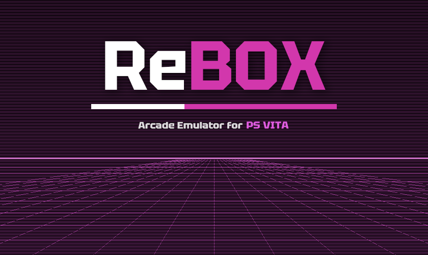

<p align="center">
  
</p>

<h1 align="center">ReBOX</h1>

<p align="center">
  <b>Arcade board emulator for PlayStation Vita: Taito, Konami, Data East, Seta and Irem</b><br>
  MAME drivers ported to C &middot; Musashi 68000 &middot; Z80 &middot; ymfm sound<br>
  <a href="https://www.patreon.com/Reyanon">Support on Patreon</a> or <a href="https://ko-fi.com/reyanon">Ko-Fi</a>
</p>

---

## Table of Contents

1. [Introduction](#1-introduction)
2. [Highlights](#2-highlights)
3. [Supported Games](#3-supported-games)
4. [Download](#4-download)
5. [Installation](#5-installation)
6. [Usage](#6-usage)
7. [Building from Source](#7-building-from-source)
8. [Project Layout](#8-project-layout)
9. [Accuracy and Testing](#9-accuracy-and-testing)
10. [License and Credits](#10-license-and-credits)
11. [Support](#11-support)

---

## 1. Introduction

ReBOX is an emulator for the 2D arcade boards of five makers: Taito, Konami, Data East, Seta and Irem.

Each board is a C port of its [MAME](https://www.mamedev.org/) driver: memory map, machine configuration, video
chips and sound chips follow MAME. The MAME device framework is not used; the drivers are written directly against a
small shared core, so that they run on a PS Vita at full speed.

The target for every game is a locked 60 fps on a PS Vita at 444 MHz without frame skipping, sound without dropouts,
and no errors that affect play. Every frame is emulated and drawn.

## 2. Highlights

**Core**
- Board drivers ported from MAME 0.289: Taito B, F2, F3, H, L, O, SJ, X and Z Systems; Konami TMNT, GX, Mystic
  Warriors, Nemesis, Twin 16 and others; Data East dec0, dec8, DECO 16 / 32 / 156, MLC and Cassette; Seta 1; Irem
  M52 to M107. Many single-game boards of the same makers too.
- CPUs: Musashi (68000, 68EC020), superzazu/z80, and MAME's cores for ARM, HuC6280, HD6309, 8080, Konami, 6502,
  6800, 6805, 6809, MCS-48 / 51, NEC V20-V35, TMS320C1x, TMS57002 and uPD7810.
- Sound: ymfm for the Yamaha FM chips (YM2151, YM2203, YM2610 / B, ...) and ports of MAME's PCM and PSG chips
  (OKI MSM6295, AY-3-8910, K007232, K053260, K054539, ES5505, X1-010, YMZ280B, ...).
- Game lists, ROM layouts and input ports (with DIP switches) are generated from the MAME sources.
- Drawing runs on its own CPU core, so emulation and drawing of a frame overlap.

**Frontend**
- Game list with a tab for each maker, grouped by board, genre, publisher or year, and a Playable / All /
  Favorites filter. Snaps and marquees from your own folders.
- Save states (10 slots plus quick save / load), DIP switches, test mode, cheats where the driver has them.
- Button mapping with turbo and combo keys, two players, external controllers. Bluetooth pads the Vita does not
  accept by itself work through the bundled [RePad](https://github.com/Reyanon/RePad) plugin.
- Touch buttons and touch in the game list and the menus.
- Display options: screen size, rotation, filter, scanlines (CRT soft / sharp, every 2 / 3 / 4 px), border
  (black, graphic, color or marquee), frame rate counter.
- Per-game settings, menu themes, and in-app updates from GitHub.
- Medal games (Taito O System) with an on-screen cabinet panel (lamps, hopper, medal counters).

## 3. Supported Games

Set names are the MAME set names. ROMs must match the MAME romset (see [ROM sets](#rom-sets)). The game list in
the app shows every set, with its board, year, publisher and genre.

| Maker | Sets | Boards |
|---|---|---|
| Taito | 697 | B, F2, F3, H, L, O, SJ, X and Z Systems, classic and single-game boards |
| Data East | 439 | DECO Cassette, Karnov, dec0, dec8, DECO 16, DECO 32, DECO 156, MLC, classic and single-game boards |
| Konami | 429 | TMNT, TMNT 2, GX, Mystic Warriors, Nemesis, Super Contra, Twin 16, medal, classic and single-game boards |
| Irem | 190 | M52, M57, M58, M62, M63, M72, M90, M92, M107 and classic boards |
| Seta | 67 | Seta 1 (Seta, Banpresto, Allumer and others) |

**Speed.** Measured on a PS Vita at 444 MHz in play (coin, start, buttons pressed). Most parent sets run at 60 fps
with no sound dropouts. Known exceptions:

| Set | FPS | Notes |
|---|---|---|
| `tattass` (Tattoo Assassins) | about 45 | the BSMT2000 sound DSP is too heavy |
| `thndzone` (Thunder Zone) | about 59 | |

**Fourth CPU core.** The speed was measured with the Vita's fourth CPU core open to the app. ReBOX opens it by itself
when the system code matches the one verified on firmware 3.65 (an empty file `ux0:data/rebox/nocpu3` turns this
off). With the core closed, the heaviest games run slower (Riding Fight about 53 fps). The app sets 444 MHz by itself,
so an overclock plugin is not needed.

**Known issues**
- Irem 8-bit boards (M52, M58, M62, M63): sound is the plain mix of the AY and MSM chips, without the board's filter
  and drum circuits.
- Real Puncher (Taito B System) is not emulated (camera board).
- 21 sets list ROM files that are not in the MAME 0.260 romsets (for example `cameltry`, `wgp2`, `dietgo`,
  `brkthru`, `gradius3j`). They stay in the list and start when the zip has the files the current MAME expects.

## 4. Download

Prebuilt binaries are published on the [Releases](../../releases) page:

| File | Platform | Contents |
|---|---|---|
| `ReBOX_vX.Y.Z_vita.zip` | PS Vita / PS TV | `ReBOX_vX.Y.Z_vita.vpk`, the game lists in `data/rebox/gamelist/` and an empty `data/rebox/roms/` folder |

The releases contain the emulator only. **No ROMs or game artwork are included or provided.**
You must supply ROM images of games you own.

## 5. Installation

### PS Vita

Requirements:
- A PS Vita or PS TV that can install homebrew VPK files with [VitaShell](https://github.com/TheOfficialFloW/VitaShell).
- No extra plugin or system file is needed.

**Install the VPK**

1. Extract `ReBOX_vX.Y.Z_vita.zip` on your PC.
2. Start VitaShell on the Vita and connect it to the PC:
   - USB: press **SELECT** in VitaShell, connect the cable, and the memory card appears as a drive; or
   - FTP: press **SELECT** in VitaShell and connect an FTP client to the address shown on screen.
3. Copy `ReBOX_vX.Y.Z_vita.vpk` to `ux0:` (any folder, for example `ux0:downloads/`).
4. Disconnect, open the folder in VitaShell, select the `.vpk` and press **X** to install.
   Accept the extended permissions prompt. A **ReBOX** bubble appears on the home screen (title ID `RBOX00001`).
5. The `.vpk` file can be deleted after installation.

**Copy the game lists and add ROMs**

1. Copy the `data` folder from the zip to the root of `ux0:`, so that the game lists are in
   `ux0:data/rebox/gamelist/` and the empty folder is `ux0:data/rebox/roms/`. The game lists are not inside the
   VPK: without them the list shows set names only.
2. Put your ROM zips in `ux0:data/rebox/roms/`, unchanged and not extracted, for example
   `ux0:data/rebox/roms/pbobble.zip`.
3. Start ReBOX. The *Playable* filter shows the sets whose zip was found.

Updates installed from inside the app also refresh the game lists.

### ROM sets

- **Required MAME version: non-merged romsets from MAME 0.260.** 0.260 is the version we test with. The drivers and
  the set list come from the MAME 0.289 source, so a few sets changed after 0.260 (see Known issues). Romsets older
  than 0.260 are not tested.
- Keep each set as one zip named after the set, for example `pbobble.zip`. Do not rename or extract them.
  Files inside the zip are matched by CRC32, so their names do not matter.
- Non-merged sets are recommended. Clone sets can also read missing files from the parent zip in the same folder.
- CHD images are not used.

### Optional files

| What | Path |
|---|---|
| Game lists (tabs, titles, boards, genres; editable JSON) | `ux0:data/rebox/gamelist/*.json` |
| Border artwork | `ux0:data/rebox/artwork/<set>.png` (or `.jpg`) |
| Snaps shown in the game list | `ux0:data/rebox/snap/<set>.png` (or `.jpg`) |
| Marquees (list and *Marquee* border) | `ux0:data/rebox/marquees/<set>.png` (or `.jpg`) |

Files written by the emulator:

| What | Path |
|---|---|
| Settings and favorites | `ux0:data/rebox/settings.cfg`, `ux0:data/rebox/favorites.cfg` |
| Per-game settings | `ux0:data/rebox/cfg/` |
| Touch button layout | `ux0:data/rebox/touch.cfg` |
| NVRAM and EEPROM (high scores, test mode settings) | `ux0:data/rebox/nvram/` |
| Save states | `ux0:data/rebox/states/<set>_<slot>.sav` |

## 6. Usage

**Game list**

| Action | Buttons |
|---|---|
| Start the selected game | Cross (or Circle, see Controls) |
| Change tab (maker) | L / R |
| Add / remove favorite | Square |
| Search by ROM name or title | Triangle (again: all games) |
| Filter: Playable / All / Favorites | SELECT |
| Options (Display, Controls, About) | START, or the buttons at the bottom of the screen |

**In game**

| Action | Buttons |
|---|---|
| Lever | D-pad and left stick |
| Buttons 1-6 | Face buttons, L, R (set in Controls, per game if wanted) |
| Coin / Start | SELECT / START |
| Open the in-game menu | SELECT + START, or the PS button |
| Quick save / quick load | SELECT + L / SELECT + R |

The in-game menu provides: Resume, Reset, Save / load state (10 slots), DIP switches, Display, Controls, Cheats,
per-game settings and Select game.

**Controllers.** Controls has a page for each player with its device (Vita, or an external controller) and the
buttons, analog stick, turbo and combo keys of that device. *Input engine* picks Native (the Vita's own controls and
the controllers the system supports), RePad (Bluetooth pads such as the Switch Pro Controller or a DualShock 4 on a
handheld Vita) or VitaControl (when that plugin is installed).

**Touch buttons.** Controls > Touch controls: place on-screen buttons, move and resize them, pick their keys.

## 7. Building from Source

Builds are done on Linux or WSL (Ubuntu 24.04 is used for development).

### Prerequisites

```bash
sudo apt install -y build-essential cmake ninja-build git python3
```

- [VitaSDK](https://vitasdk.org/) with `libvita2d`, `libpng`, `libjpeg-turbo`, `zlib` and `mbedtls`
  (`vdpm` install-all), `VITASDK` set.

### PS Vita

```bash
bash tools/build.sh vita Release -DRBX_LOG=OFF   # build-vita/eboot.bin and build-vita/rebox.vpk
```

## 8. Project Layout

```
src/core/            shared core: front-end API, ROM loader (zip, CRC), MAME input ports and DIP switches, save states
  cpu/ sound/        CPU cores and sound chips shared by the makers
  machine/ video/    shared devices and video chips
  taito/ konami/ deco/ seta/ irem/    one module for each maker: board drivers, custom chips, generated tables
vita/                PS Vita port: frontend, video output (libvita2d), kernel helper, RePad, LiveArea assets
vita/res/gamelist/   the game lists shipped in the release zip
```

## 9. Accuracy and Testing

- Every performance change is checked against a desktop test harness (kept in the development tree): frame and
  audio hashes are compared before and after over thousands of frames.
- Each game must run the same after another game was played: the drivers' and chips' state is reset on every start,
  and switching between sets of a board is checked against the hashes of a fresh start.
- Sound in play (coin, start, a few seconds of play) is recorded and compared with MAME's output for the same input.
- Speed is measured on a Vita in play, with frame time and audio underrun counters.

## 10. License and Credits

**License.** ReBOX is distributed under the [GNU General Public License, version 3](LICENSE).
- The ReBOX code and the parts ported from MAME are GPL-2.0-or-later or BSD-3-Clause, as stated at the top of each file.
- Musashi and superzazu/z80 are MIT, ymfm is BSD-3-Clause.

The original copyright headers are kept in all imported sources.

**Credits**
- [MAME](https://www.mamedev.org/) developers: board drivers, video and sound chips, CPU cores, ROM definitions and
  hardware research.
- [Musashi](https://github.com/kstenerud/Musashi) (Karl Stenerud), [superzazu/z80](https://github.com/superzazu/z80),
  [ymfm](https://github.com/aaronsgiles/ymfm) (Aaron Giles).
- [catver.ini](https://github.com/AntoPISA/MAME_SupportFiles) (AntoPISA): game genres in the game lists.
- [VitaSDK](https://vitasdk.org/), [libvita2d](https://github.com/xerpi/libvita2d) (xerpi),
  [Mbed TLS](https://github.com/Mbed-TLS/mbedtls), [libpng](https://github.com/pnggroup/libpng),
  [libjpeg-turbo](https://github.com/libjpeg-turbo/libjpeg-turbo), [zlib](https://zlib.net/).

**Trademarks.** Taito, Konami, Data East, Seta, Irem and all game titles are trademarks of their respective owners.
This project is not affiliated with or endorsed by any of them or any rights holder. No ROM images, game graphics or
logos are included in this repository or in the release packages.

## 11. Support

ReBOX is free software. If you want to support its development, you can do so on
[Patreon](https://www.patreon.com/Reyanon) or [Ko-Fi](https://ko-fi.com/reyanon). Support is for the emulator work only.

**ROMs are never provided, to anyone, including supporters.** Do not ask for them.
